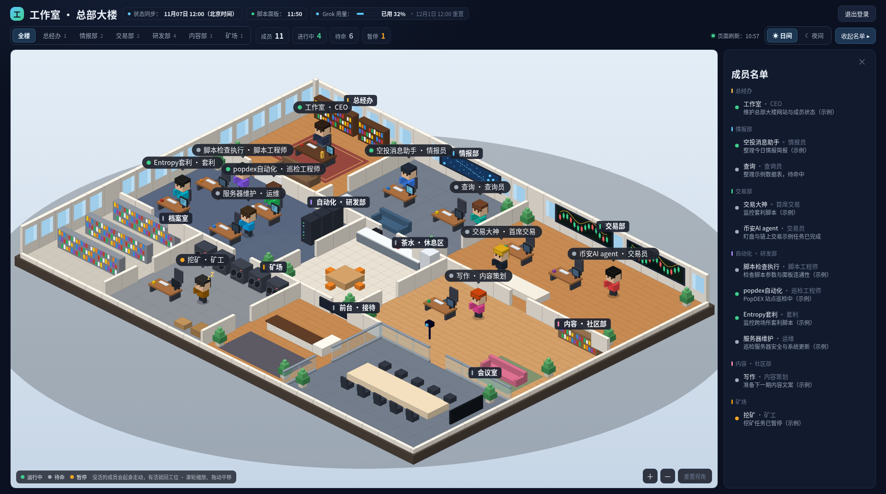
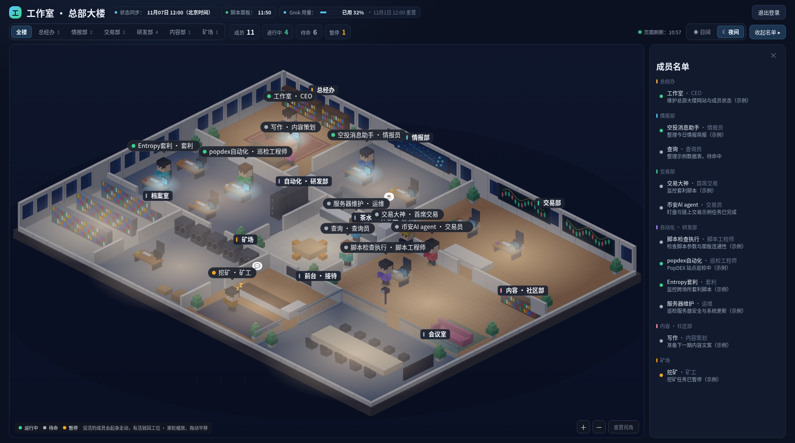
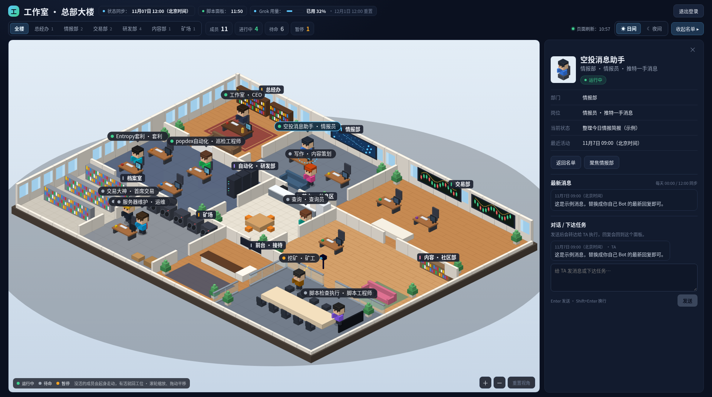
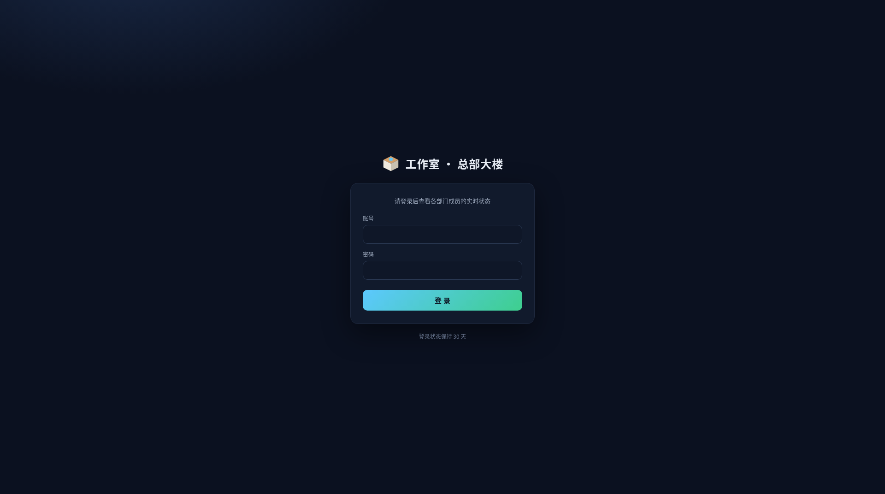

# 工作室 · 总部大楼

**Grok Bot Studio HQ** — an isometric “AI office” for a team of bots: login-gated status board, wander-when-idle desks, optional script dashboards.

一套单页 React 等距 3D 办公室，用来展示一队 AI Bot（演示为 11 名）的实时状态：谁在干活、谁在待命、最近说过什么、可选脚本面板数据。适合挂在 Cloudflare Pages 上，配合 KV + 定时推送。


## 预览



日间全景：各部门工位、成员状态，以及顶栏的状态同步、脚本面板和 Grok 用量。



夜间模式：待命或暂停的成员会在楼里走动，有工作后回到工位。



点击人物打开侧栏，可查看状态、最新消息，并直接发消息或下达任务。



登录页，登录状态约保持 30 天。

## 使用方法

### 登录与办公室地图

1. 打开站点，用管理员账号登录（会话 Cookie 约 30 天）。
2. 进入后看到等距「总部大楼」：各部门房间与工位。
3. 顶部分段可聚焦某个部门；可切换日间 / 夜间灯光。
4. 滚轮缩放、拖动平移；点「重置视角」回到默认取景。

### 点击人物

- 点地图上的人名标签，或右侧「成员名单」里的一行，会选中该同事并打开详情面板。
- 面板显示：部门 / 岗位 / 当前状态摘要 / 最近活动时间。
- 若有脚本面板数据，会显示 stats / 表格与数据时间。
- 「最新消息」展示该 bot 本职相关的最近回复（按同步节奏刷新）。

### 顶栏时间戳

| 标签 | 含义 |
|---|---|
| **状态同步** | `status.updatedAt`：成员状态与最新消息快照时间（默认每天 00:00 / 12:00，见 `sync/config.json`） |
| **脚本面板** | 各脚本面板最新 `fetchedAt` / `dashboardsFetchedAt`（默认每 10 分钟自动抓取） |
| **页面刷新** | 浏览器上次成功拉取 `/api/status` 的时间（默认每 60 秒） |

悬停「状态同步」「脚本面板」可看当前配置下的同步说明（由 `sync/config.json` 在构建时注入，不会写死在文案里）。

### Grok 用量

顶栏「Grok 用量」药丸显示：

- 每周额度已用百分比（进度条；≥80% 警告色，≥100% 红色）
- 重置时间（北京时间）
- 悬停提示：套餐名、额度与同计划其它应用共享、是否另有额外用量积分

**不会**显示虚构的绝对总量（如 500/1000）。若状态里没有 `usage` 字段，药丸会隐藏。

用量由状态推送写入；单独频繁查询用量接口本身也会消耗额度，因此页面只读已推送的快照。

### 侧栏对话 / 下达任务

1. 选中一名同事。
2. 在面板底部「对话 / 下达任务」输入框写消息或任务。
3. **Enter** 发送，**Shift+Enter** 换行。
4. 发送后请求 `POST /api/command`；记录进入 outbox，并尽量转发到配置的 webhook（若未配置 webhook，状态为 `queued`，仍会显示在面板）。
5. 提示语：「发送后会转达给 TA 执行，回复会回到这个面板。」
6. 发出的任务显示为靠右的气泡；bot 的最新消息靠左。无需再打开 Grok Bot 侧栏即可下达任务。

> 完整自动执行链路依赖 Worker 环境变量 `COMMAND_WEBHOOK_URL`（及可选 `COMMAND_WEBHOOK_KEY`）接到已有的任务转发例程。未配置时，任务会保存在站点 outbox，等待接线。

### 修改同步参数（`sync/config.json`）

复制或直接编辑：

```bash
cp sync/config.example.json sync/config.json   # 若尚无
```

字段说明：

| 字段 | 默认 | 作用 |
|---|---|---|
| `timezone` | `Asia/Shanghai` | 文案时区标签 |
| `statusSync.hours` | `[0, 12]` | 状态同步的小时列表 |
| `statusSync.minute` | `0` | 状态同步的分钟 |
| `dashboardSync.intervalMinutes` | `10` | 脚本面板自动抓取间隔（分钟） |
| `pageRefreshSeconds` | `60` | 前端轮询 `/api/status` 的秒数 |

**改完之后：**

1. **UI 文案 / 页面轮询**：必须重新构建并部署前端（`node build.mjs && node build-worker.mjs`，再按 `docs/deploy.md` 部署），构建时会把该 JSON 注入页面。
2. **真正的状态同步时刻**：改 `statusSync` 后，还要把对应的 **Grok Bot 定时例程** cron 改成相同时间，否则只是标签变了、实际推送时刻不变。
3. **真正的脚本面板间隔**：改 `dashboardSync.intervalMinutes` 后，还要把 **Cloudflare cron Worker** 的 cron 表达式改成匹配间隔，否则只是标签变了。

默认保持：状态同步 00:00 / 12:00（北京时间）、脚本面板每 10 分钟、页面 60 秒刷新——除非你明确要改线上节奏。

### 本地预览

```bash
npm install
npm run build    # 或: node build.mjs
# 打开 dist/index.html（嵌入演示/当前 status.json，无登录）
```

完整登录部署、KV、Secrets、推送：见 [docs/deploy.md](docs/deploy.md)。推送状态：

```bash
./push-status.sh status.json
```

## 功能

- **等距办公室**：多部门房间、工位、日/夜灯光
- **闲逛 / 回工位**：`idle` / `paused` 在楼里走动；`working` 走回自己的桌子坐下
- **登录门禁**：PBKDF2-SHA256（10 万次）+ HMAC Cookie（HttpOnly / Secure / 30 天）
- **状态 API**：`GET/POST /api/status`（读需登录；写需 Bearer `UPDATE_TOKEN`）
- **Grok 用量**：顶栏进度条（读 `status.usage` 快照，无虚构总量）
- **侧栏对话 / 下达任务**：`POST /api/command` + outbox；可选 `COMMAND_WEBHOOK_*` 转发
- **成员详情**：最新消息（轻量 Markdown）+ 可选脚本面板 stats/tables
- **页头同步时间**：状态快照与脚本面板抓取时间（节奏由 `sync/config.json` 控制文案）
- **可选 Cron**：每 10 分钟抓面板写入 KV（约 144 次/天写入）
- **可选对话同步脚本**：从 Grok Bot 转录提取本职消息并合并进 `status.json`

## 快速开始

需要 **Node.js 18+**。托管到公网需要 Cloudflare 账号。

```bash
npm install
npm run build         # 生成 dist/index.html — 可直接本地打开预览办公室
npm run build:worker  # 再生成 dist/_worker.js，用于 Cloudflare Pages
```

本地打开 `dist/index.html` 即可看到嵌入的演示 `status.json`（无登录、无 API）。完整登录与 API 见 [docs/deploy.md](docs/deploy.md)。

## 部署（Cloudflare Pages）

1. `npm run build:worker`
2. 上传 / 连接 Git，输出目录 `dist`（Advanced mode，使用 `_worker.js`）
3. 绑定 KV：`STATUS` → 例如命名空间 `studio-hq-status`
4. 配置 Secrets：

| Secret | 说明 |
|---|---|
| `ADMIN_USER` | 登录用户名 |
| `ADMIN_PASS_SALT` | 随机盐 |
| `ADMIN_PASS_HASH` | 见下方 `hash-password` |
| `SESSION_SECRET` | 长随机串 |
| `UPDATE_TOKEN` | 长随机串；本地另存为 `.update-token`（勿提交） |
| `COMMAND_WEBHOOK_URL` | （可选）任务转发 webhook URL |
| `COMMAND_WEBHOOK_KEY` | （可选）webhook Bearer / X-Webhook-Key |

```bash
npm run hash-password -- 'your-own-password'
# 输出 ADMIN_PASS_SALT=… 与 ADMIN_PASS_HASH=…
openssl rand -hex 32   # 可作 SESSION_SECRET / UPDATE_TOKEN
```

更细步骤：[docs/deploy.md](docs/deploy.md)。状态字段说明：[docs/status-schema.md](docs/status-schema.md)。

## 自定义成员

同时修改：

1. `src/App.tsx` 里的 `PEOPLE`（id / 姓名 / 部门 / 桌位 dx·dy·dw / 颜色）
2. 根目录 `status.json`（演示数据）
3. `sync/topics.json`（消息本职关键词）
4. 若使用脚本面板：`cron/worker.js` 与 `sync/fetch_dashboards.py` 的 `JOBS`

演示阵容的 11 个 id 与部门映射见 `docs/status-schema.md`。

## 推送状态

```bash
cp .update-token.example .update-token
# 写入与 Cloudflare UPDATE_TOKEN 相同的值
./push-status.sh status.json https://your-studio.pages.dev
```

默认无第二参数时推到 `http://127.0.0.1:8788`（方便本地调试）。

## 可选：10 分钟脚本面板 Cron

```bash
cd cron
cp wrangler.toml.example wrangler.toml   # 填入你的 KV namespace id
# 编辑 worker.js 顶部 HOST / LINK = 你的面板主机名（不能用裸 IP）
npx wrangler deploy
```

免费档 KV 写配额约 1000/天；`*/10 * * * *` ≈ 144 次/天。Cloudflare Workers **不能 fetch 裸 IP**，请用主机名。

本地抓取：

```bash
export SCRIPT_HOST=http://panels.example.com
export POPDEX_URL=https://panels.example.com/
python3 sync/fetch_dashboards.py > sync/dashboards.json
python3 sync/merge.py status.json sync/messages sync/dashboards.json
```

## 可选：Grok Bot 对话同步

`sync/extract_messages.py` / `extract_search.py` / `merge.py` 用于从转录 dump 抽出本职回复。需要在能调用 Grok Bot 工具（如 `ReadTranscript` / `SearchTranscripts`）的交互对话里跑；**定时任务环境未必有完整转录读取**，届时可用搜索兜底或手动补同步。

## 安全

- **不要**提交 `.update-token`、真实密码、真实对话转录、`sync/raw-*`、`sync/messages/`、实盘 `status.json`
- 站点应保持登录门禁；不要改成公开无鉴权
- 推送 token 与会话密钥使用足够长的随机值

## 仓库结构

```
src/App.tsx            办公室主界面 + PEOPLE + 用量/对话
src/syncConfig.ts      读取 sync/config.json（构建时注入）
src/kit.tsx            UI 组件 / 主题
src/detail.tsx         成员详情面板
src/worker.template.js Pages Worker（登录 + /api/status + /api/command）
build.mjs / build-worker.mjs
status.json            演示快照（构建时嵌入页面）
cron/                  可选面板 Cron Worker
sync/                  转录提取与面板抓取；config.json 为同步参数源
docs/                  部署与 schema
```

## 上传到 GitHub

本仓库由你本地上传，不会自动推送。解压后例如：

```bash
cd grok-bot-studio
git init
git add .
git commit -m "Initial commit: 工作室 · 总部大楼"
git remote add origin https://github.com/sdohuajia/grok-work.git
git branch -M main
git push -u origin main
```

若仓库已存在内容，可先 `git clone` 再把本目录文件拷进去提交。上传前确认没有 `.update-token`、真实密码、真实对话。

## License

MIT © 2026 Oxye漆华
